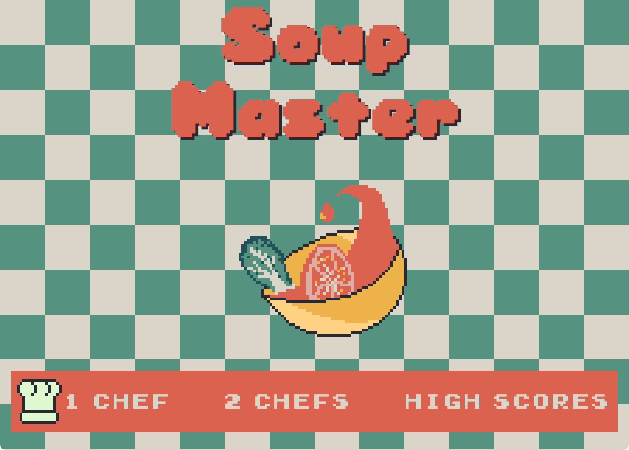
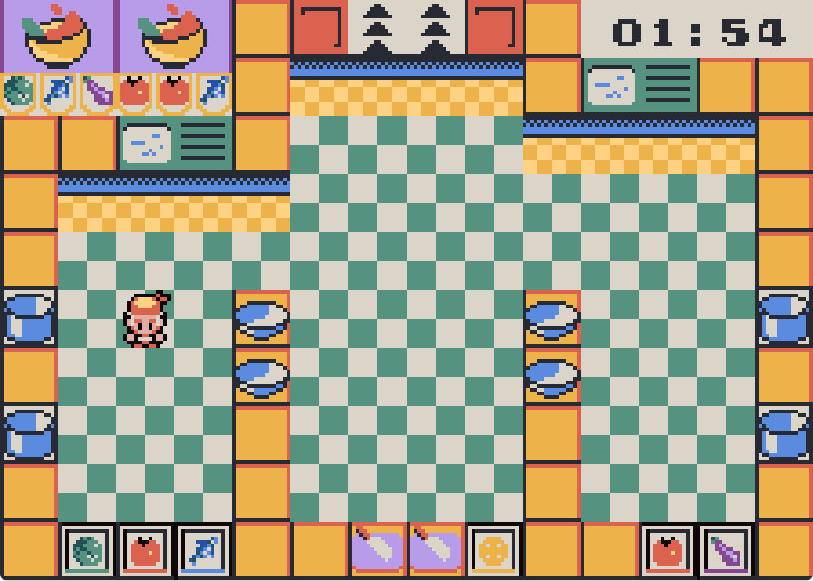
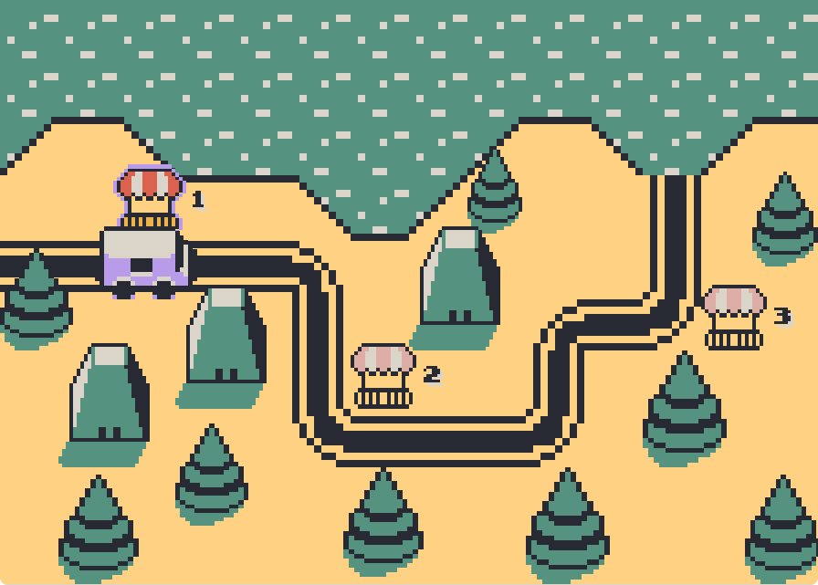

# Soup Master

An Overcooked-inspired pixel-art cooking game for 1–2 players. Prepare ingredients, cook soup, and serve orders before time runs out.

| Menu | Kitchen | World map |
| --- | --- | --- |
|  |  |  |

## Gameplay

Collect and chop ingredients, cook three portions in a pot, then plate the soup and serve either of the two active orders. Wash dirty bowls to reuse them.

Serve **2 / 3 / 4+ soups** to earn **1 / 2 / 3 stars**. One star unlocks the next kitchen.

| Action | Player 1 | Player 2 |
| --- | --- | --- |
| Move | WASD | Arrow keys |
| Chop / Wash (hold) | V | . |
| Pick up / Put down | B | / |
| Pause / Resume | Q | P |

On the world map, drive with WASD or arrow keys and press Enter / Space near an unlocked kitchen to enter.

## Run

With Rust installed, run from the project directory:

```sh
cargo run --release
```
